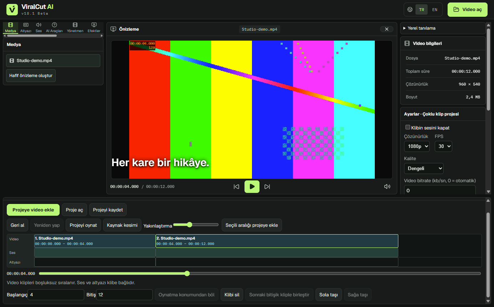
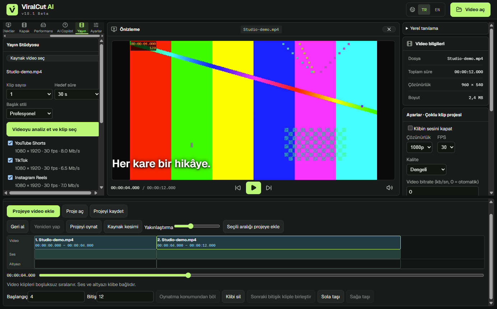

  

# ViralCut AI Desktop

**v19.0.0 Professional Timeline 2.0 · Windows x64 · Türkçe / English**

Yerel video düzenleme, otomatik altyazı ve dikey video hazırlama uygulaması.

A local video editor for cutting footage, generating captions, and preparing vertical clips.

[Türkçe](#türkçe) · [English](#english) · [Ekran görüntüleri / Screenshots](#ekran-görüntüleri--screenshots) · [Sürümler / Releases](https://github.com/hculgatay6-code/ViralCut-AI/releases) · [Değişiklik günlüğü / Changelog](CHANGELOG.md)

## v19.0.0

Bu kaynak dalı v19'u içerir. Aşağıdaki Windows indirmeleri yayımlanmış v18.1 Beta paketleridir. v19 test kapsamı ve dağıtım durumu [Türkçe test raporunda](V19_TEST_RAPORU.md) yer alır.

This source branch contains v19. The Windows downloads below are the published v18.1 Beta packages. See the [v19 test report](V19_TEST_RAPORU.md) for validation and distribution status.

## Türkçe

### Neler yapabilirsin?

| Özellik | Kullanım |
| --- | --- |
| Çoklu klip düzenleme | MP4 ve WebM aç, önizle, klipleri kes, sırala veya birleştir. |
| Otomatik altyazı | Yerel Whisper ile konuşmayı yazıya dök, metni düzelt, SRT/VTT kaydet veya altyazıyı MP4’e işle. |
| Sessizlik ve ses | Sessizlikleri bul, seçtiğin aralıkları kaldır ve konuşma sesini düzenle. |
| Dikey video | Kadrajı düzenle, Shorts adaylarını incele ve YouTube Shorts, TikTok veya Instagram Reels için ayrı yerel 9:16 paketler oluştur. |
| Dışa aktarma | MP4 olarak kaydet. Uyumlu NVIDIA donanımında NVENC, diğer durumlarda CPU kullanılabilir. |
| Proje ve kurtarma | Projeyi kaydet, yeniden aç, otomatik kayıt aralığını değiştir ve beklenmeyen kapanış sonrası kurtarma kaydını yükle. |

### Professional Timeline 2.0

1. **Projeye video ekle** veya **Proje aç** ile başla. **Katmanlı düzen** seçeneği V1, A1 ve CC1 kanallarını oluşturur.
2. Medyayı sol panelden uyumlu bir katmana sürükle veya medyayı seçip **İmlece ekle**. Bağımsız WAV, MP3 ve M4A dosyaları için **Ses dosyası ekle** seçeneğini kullan.
3. Aynı katmanda klipler çakışamaz. Üstte görünen video katmanları alttakilerin üzerine bindirilir. Klip kenarlarını sürükleyerek kırp. Sağ panelden kare konumunu, ölçeği, opaklığı veya katman sesini ayarla.
4. Ctrl veya Shift ile klipleri birlikte seç. Ctrl+C/V/D kopyalar, yapıştırır ve çoğaltır. S imleçte böler. Delete siler. Ok tuşları imleci bir kare oynatır. Ripple modu aynı katmanda silme ve bitiş kırpma sonrası gelen klipleri kaydırır.
5. **Buradan 8 sn önizle** aynı FFmpeg kompozisyonunun kısa bir bölümünü üretir. **Katmanları MP4 hazırla** ile kompozisyonu bütünüyle dışa aktar.

v1 dosyaları doğrudan açılır. Katmanlı düzeni etkinleştirip kaydedince dosya v2 olur. Önceki klipler, kaynak altyazılar, efektler ve geçişler **Eski düzen** görünümünde saklanır. Katmanlı düzen başlangıçta kareye hizalanmış kesimleri ve düz altyazı bloklarını alır. Eski ve katmanlı düzen bağımsız kurgulardır. Rapor; önizleme, eşzamanlı katman ve sürüm sınırlarını açıklar.

### Yayımlanmış v18.1 Beta paketleri

| Paket | Kullanım |
| --- | --- |
| [Setup EXE](https://github.com/hculgatay6-code/ViralCut-AI/releases/download/v18.1-beta/ViralCut-AI-v18.1-beta-Setup.exe) | Kurulum, masaüstü ve Başlat menüsü kısayolları ve Windows üzerinden kaldırma. |
| [Portable ZIP](https://github.com/hculgatay6-code/ViralCut-AI/releases/download/v18.1-beta/ViralCut-AI-v18.1-beta-Portable.zip) | ZIP’in tamamını klasöre çıkar ve içindeki EXE’yi çalıştır. |
| [SHA-256](https://github.com/hculgatay6-code/ViralCut-AI/releases/download/v18.1-beta/SHA256SUMS-v18.1-beta.txt) | Setup EXE’yi veya ZIP’ten çıkarılan Portable EXE’yi doğrula. |

Windows 10/11 x64 hedeflenir. Windows 11 ve yaklaşık 16 GB RAM ile doğrulandı. Windows 10/8 GB testi bekliyor. Diskte video ve geçici dışa aktarma dosyaları için alan ayır. Node.js ve npm son kullanıcı için gerekmez. Whisper, x64 Visual C++ çalışma zamanına ihtiyaç duyabilir.

1. Setup’ı çalıştır veya Portable EXE’yi aç. İndirdiğin dosyanın SHA-256 değerini doğrula.
2. **Video aç** veya **Projeye video ekle** ile bir dosya seç. Projeyi özgün videolarla birlikte sakla.
3. Otomatik altyazıda **Altyazı** bölümünden doğrulanmış Whisper Base Q5 modelini seç. Görsel ve semantik modeller de ayrı kurulur.
4. **Projeyi dışa aktar** ile MP4 kaydet. Platform paketleri için **Yayın** sekmesini aç.

### Beta ve gizlilik

- Paketler imzasızdır. Yayımlanan 18.1 Beta’nın paketli medya araçları ve dağıtım lisans kapsamı için [güvenlik raporunu](SECURITY_AUDIT.md) ve [üçüncü taraf bildirimlerini](THIRD_PARTY_NOTICES.md) incele. Bilinmeyen kaynaklardan gelen medya dosyalarını bu sürümde açma.
- Yerel düzenleme ve analiz videoyu bir bulut hizmetine göndermez. Proje ve kurtarma dosyaları kaynak yolları ile altyazı metinleri içerebilir. Dışa aktarılan tanılama raporu sınırlı işlem ve hata bilgisi içerir. Uygulama raporu kendiliğinden göndermez.
- Güncelleme kontrolü istek üzerine GitHub’a bağlanır ve kurulum yapmaz. YouTube’a gönderme ayrı OAuth bağlantısı ve açık onay gerektirir. Canlı yayın akışı doğrulanmadı. TikTok ve Instagram’a yükleme elle yapılır. Takvim, uygulama kapalıyken yayın başlatmaz.

## English

### Professional Timeline 2.0

From a project, open **Multitrack editor**. Add video, audio, caption or text tracks. Drag media from the library onto a compatible track or use **Add at playhead**. Higher video tracks composite over lower tracks. Audio tracks have independent volume, mute and solo controls. Drag clip edges to trim, or use frame positions in the inspector. Overlaps within a track are rejected. **Preview 8 s from playhead** and **Render layers to MP4** use the same composition engine.

Version 1 projects remain readable. Saving the multitrack edit creates a version 2 project with the original sequence, effects and captions available in **Legacy sequence**. The layered copy starts from cuts and plain caption blocks. The two edits have independent clip state.

### What you can do

| Feature | Use |
| --- | --- |
| Multi-clip editing | Open and preview MP4 or WebM, trim, split, reorder, and join clips. |
| Automatic captions | Transcribe speech locally with Whisper. Edit captions, save SRT/VTT, or burn captions into MP4. |
| Silence and audio | Detect silence, remove selected intervals, and apply speech audio processing. |
| Vertical clips | Adjust framing, review Shorts candidates, and export separate local 9:16 packages for YouTube Shorts, TikTok, and Instagram Reels. |
| MP4 export | Export with NVENC on supported NVIDIA hardware or use the CPU encoding path. |
| Projects and recovery | Save and reopen projects, configure autosave, and recover after an unexpected exit. |

### Install and use

Windows 10/11 x64 is the target. Windows 11 with about 16 GB of RAM was tested. Windows 10 with 8 GB is pending. Leave free disk space for media and temporary exports. Node.js and npm are unnecessary for the packaged app. Whisper may require the x64 Visual C++ runtime.

1. Run [Setup](https://github.com/hculgatay6-code/ViralCut-AI/releases/download/v18.1-beta/ViralCut-AI-v18.1-beta-Setup.exe) for shortcuts and uninstall support. For a portable copy, extract the [Portable ZIP](https://github.com/hculgatay6-code/ViralCut-AI/releases/download/v18.1-beta/ViralCut-AI-v18.1-beta-Portable.zip) and run the EXE. The [checksums](https://github.com/hculgatay6-code/ViralCut-AI/releases/download/v18.1-beta/SHA256SUMS-v18.1-beta.txt) cover the installer and the extracted portable EXE.
2. Open a video or add videos to a project, then edit in the timeline. Keep the original media accessible.
3. Choose a verified local Whisper Base Q5 file in **Subtitles** for transcription. Visual and semantic models are separate.
4. Export your project to MP4 or use **Publishing** to create platform packages.

### Beta and privacy

- The Windows packages are unsigned. See the [security audit](SECURITY_AUDIT.md) and [third-party notices](THIRD_PARTY_NOTICES.md) for the published build’s media-tool review and distribution status. Use trusted media inputs with this version.
- Local editing and analysis run on the device. Projects and recovery files can contain media paths and caption text. Diagnostic exports contain limited event and error data. The app does not send reports automatically.
- Version checks contact GitHub on demand and never install updates. YouTube upload requires a separate OAuth connection and final confirmation. Live publishing is unverified. TikTok and Instagram uploads are manual. The calendar does not publish when the app is closed.

## Ekran görüntüleri / Screenshots

Gerçek Windows v18.1 Beta arayüzünden, test videosuyla alınmıştır.

Captured from the Windows v18.1 Beta app with a test video.

| Editör / Editor | Yayın Stüdyosu / Publishing Studio |
| --- | --- |
|  |  |

## Hata bildirimi ve katkı / Issues and contributions

Tekrar üretilebilen kullanım hataları için Windows sürümünü, uygulama sürümünü, beklenen sonucu ve kısa adımları yaz. Katkı önerisini önce bir Issue’da tartış; bir PR açarken yapılan değişikliğin testini paylaş. Videoları, proje dosyalarını, erişim anahtarlarını ve kişisel bilgileri Issue’lara ekleme. Güvenlik bulguları için [özel bildirim politikasını](SECURITY.md) kullan.

For normal bugs, include Windows and app versions, the expected result, and short reproduction steps. Discuss contributions in an issue first and include test results in your PR. Keep media files, projects, keys, and personal information out of issues. Use the [private disclosure policy](SECURITY.md) for security findings.

[GitHub Issues](https://github.com/hculgatay6-code/ViralCut-AI/issues) · [Kurulum ve geliştirme / Development](docs/DEVELOPMENT.md) · [Test raporu / Test report](V18_1_BETA_TEST_RAPORU.md)

## Lisans / License

ViralCut AI’ın uygulama kodu için [beta lisansı](LICENSE), üçüncü taraf bileşenler için [kendi lisansları](THIRD_PARTY_NOTICES.md) geçerlidir.

The [beta license](LICENSE) covers the application. Bundled dependencies follow their [own licenses](THIRD_PARTY_NOTICES.md).
